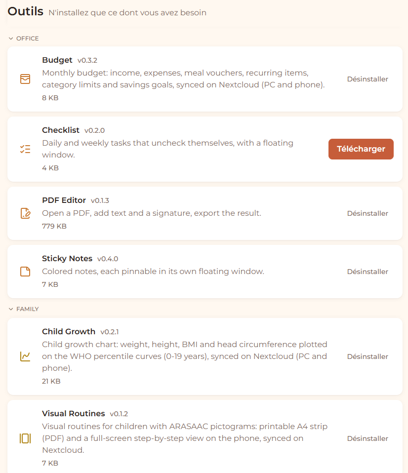

# ExziHub : une application de bureau dont chaque outil est un plugin

Tauri 2 (Rust) · React · TypeScript · Vite · Python · Windows et Android



ExziHub regroupe des outils du quotidien dans une seule application légère. **Tout est
plugin** : chaque outil s'installe, se met à jour et se désinstalle depuis l'écran
*Tools*, sans retélécharger l'application. Un plugin peut embarquer son propre moteur
Python (OCR, automatisation), que le hub lance et surveille.

Dix-huit plugins tournent au quotidien : budget, éditeur PDF, suivi de
croissance, routines pour enfant, OCR en temps réel, tableau de bord de serveur...
Ce dépôt en contient trois à titre d'exemple ; d'autres ont leur propre dépôt
avec une démo en ligne (voir plus bas).

## Architecture

```
hub/
  src/               interface React : chargement des plugins, catalogue, API window.ExziHub
  src-tauri/src/
    lib.rs           commandes communes au PC et à Android
    catalogue.rs     catalogue en ligne : installation vérifiée, mise à jour du hub
    moteurs.rs       lancement et arrêt des moteurs Python des plugins
    synchro.rs       synchronisation Nextcloud (WebDAV), veille et notifications
    tray.rs          icône de notification, instance unique
    maj_apk.rs, partage.rs, impression.rs   spécifique Android
plugins-src/
  shared/            API typée que le hub fournit aux plugins, harnais de développement
  checklist/ sticky-notes/ verif-liens/     plugins d'exemple
  publier.cjs        compile, zippe, calcule l'empreinte et publie un plugin au catalogue
```

## Choix techniques

- **Tauri plutôt qu'Electron.** L'exécutable pèse environ 13 Mo au lieu de plus de 100
  et s'appuie sur la WebView du système. Le même code donne aussi une application Android.
- **Plugins chargés à chaud.** Un plugin est un bundle IIFE (`index.js` + `manifest.json`)
  qui s'enregistre auprès du hub. React est fourni par le hub (`window.ExziHub.React`) :
  une seule copie, des bundles de quelques Ko.
- **Installation vérifiée.** Le catalogue publie l'empreinte SHA-256 de chaque paquet ;
  le hub la contrôle avant d'installer, puis remplace la version précédente seulement
  si tout a réussi (y compris le `pip install` d'un moteur Python).
- **Frontière de sécurité côté Rust.** La WebView ne fournit jamais de chemin ni de
  commande : noms de fichiers filtrés, boîtes « Enregistrer sous » ouvertes par Rust,
  listes fermées pour tout ce qui touche au système. Un plugin ne peut pas sortir de
  son dossier.
- **Synchronisation sans écrasement.** Chaque écriture sur Nextcloud porte la version
  lue (`If-Match`) ; en cas de conflit, l'outil relit et réapplique sa modification.
  Piège rencontré : Apache ajoute `-gzip` à l'ETag d'une réponse
  compressée, que Nextcloud refuse ensuite (412). Le hub lit donc `OC-ETag`. Hors
  ligne, il affiche la dernière copie connue et refuse d'écrire plutôt que de perdre
  des données. La connexion passe par le Login Flow v2 de Nextcloud : le hub reçoit
  un mot de passe d'application propre, révocable, jamais le mot de passe du compte.
- **Données séparées du code.** Ce qu'écrit un moteur va dans `donnees/<id>/`, hors du
  dossier du plugin qui est remplacé à chaque mise à jour. Réinstaller un plugin
  retrouve ses réglages.
- **Moteurs Python pilotés.** Le manifeste déclare un port et une commande ; le hub
  fournit le voyant d'état, le bouton marche/arrêt et la reconnexion WebSocket, et
  arrête tout l'arbre de processus à la fermeture.

## Écrire un plugin

```ts
// plugins-src/mon-outil/src/index.tsx
import { register } from "../../shared/hub";
register("mon-outil", { Tool: MonEcran });
```

`npm run dev` dans le dossier du plugin le fait tourner seul dans le navigateur, avec
rechargement à chaud, grâce à un faux `window.ExziHub` (`shared/dev.tsx`). C'est ce
même harnais qui sert les démos en ligne ci-dessous.

## Plugins avec démo en ligne

| Plugin | Ce qu'il montre |
|---|---|
| [Opti Élevage](https://github.com/Exzitech/opti-elevage) | simulation de Monte-Carlo, Web Worker, 63 tests |
| [Éditeur PDF](https://github.com/Exzitech/editeur-pdf) | pdf.js + pdf-lib, signature, rien ne quitte la machine |
| [Budget du foyer](https://github.com/Exzitech/budget-foyer) | règles de calcul testées, provisions |
| [Courbe de croissance](https://github.com/Exzitech/courbe-croissance) | normes OMS, graphique SVG |
| [Routines visuelles](https://github.com/Exzitech/routines-visuelles) | pictogrammes ARASAAC, PDF écrit sans bibliothèque |
| [OCR en temps réel](https://github.com/Exzitech/ocr-temps-reel) | moteur Python, Tesseract, déduplication de flux |

## Compiler

```
cd plugins-src && npm install && npm run build --workspaces
cd ../hub && npm install
npm run build          # contrôle de types + build du front
npm run release        # exécutable Windows (Rust et Tauri CLI requis)
```

`hub/hub.json` contient l'adresse du catalogue de plugins (ici un exemple à remplacer).

Licence MIT.
